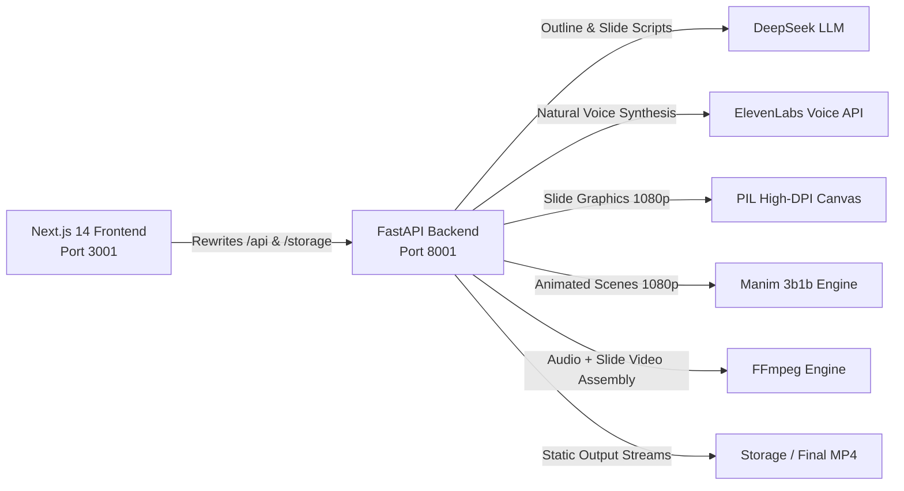

# Velix Studio 2.0 (2026 Modernized Stack)
High-definition automated educational video and narration studio powered by **DeepSeek LLM** and **ElevenLabs TTS**.

**Try it live: [velix-topaz.vercel.app](https://velix-topaz.vercel.app)**

---

## 🌟 What's New vs Legacy Architecture

| Feature | Legacy Prototype (2024) | Velix Studio 2.0 (2026) |
|---|---|---|
| **Frontend** | Streamlit Python script | **Next.js 14 App Router** (TypeScript, Tailwind CSS, Lucide icons) |
| **Backend** | Synchronous Streamlit main thread | **FastAPI** asynchronous REST API with background task orchestration |
| **LLM Engine** | OpenAI `gpt-3.5-turbo` / `gpt-4-turbo` with brittle string parsing | **DeepSeek API** (`deepseek-chat`) with structured JSON schema outputs |
| **Voice / TTS** | OpenAI `tts-1` (`alloy`, `echo`, etc.) | **ElevenLabs Voice AI** (`eleven_multilingual_v2`) with in-browser previews |
| **Video Rendering** | Headless LibreOffice + Poppler + MoviePy 1.0 | **Dual engines: Native PIL 1920x1080 High-DPI Slides + 3Blue1Brown-style Manim animation, assembled with FFmpeg** |
| **Audio-Video Sync** | Hardcoded 6-second slide clips (desync bug) | **100% exact duration alignment** matched to milliseconds of spoken voiceover |
| **Curriculum Input** | Rigid Google search scraping (CAPTHCA failure) | Pre-loaded NCERT catalogue (Classes 6-12), PDF Upload & Custom Topics |

### Rendering Engines

Velix Studio 2.0 ships with two selectable rendering engines (choose in the Slide Deck step of the UI, or via the `renderer` field of `POST /api/generate/render`):

* **PIL HD Slides** (`slides`, default) — static 1920x1080 slide cards.
Fastest option, best for quick turnaround.
* **Manim 3b1b Animation** (`manim`) — animated scenes with kinetic typography, cascading bullet reveals, and typeset formulas.
Rendering is slower, so use it when you want a polished, motion-rich lecture.
Requires the Python `manim` package (`pip install manim`); optional LaTeX (`basictex` / MacTeX) enables full MathTex formula typesetting.

---

## 🚀 Architecture



---

## 🛠️ Quick Start

### 1. Backend (FastAPI)
The backend is located in [`backend/`](backend/) and runs on port `8001`:

```bash
# Activate virtual environment
source .venv/bin/activate

# Start FastAPI server
uvicorn backend.main:app --host 127.0.0.1 --port 8001 --reload
```

### 2. Frontend (Next.js)
The frontend is located in [`frontend/`](frontend/) and runs on port `3001`:

```bash
cd frontend
npm run dev -- -p 3001
```

Open your browser at **http://localhost:3001**.

---

## 🌐 Live Deployment

| Part | Where it runs |
|---|---|
| **Frontend** | Vercel project `velix`, root directory `frontend/`, at [velix-topaz.vercel.app](https://velix-topaz.vercel.app) |
| **Backend** | FastAPI (uvicorn on port `8001`) on a Mac mini, published at `https://velix-api.hrushik.com` through the Cloudflare tunnel `velix` |

The frontend keeps calling relative `/api/*` and `/storage/*` paths.
`frontend/next.config.mjs` rewrites them to `BACKEND_URL`, which defaults to `http://127.0.0.1:8001` locally and is set to `https://velix-api.hrushik.com` on Vercel, so Vercel proxies those requests to the backend.
Vercel allows a proxied request up to 120 seconds, which is why video rendering runs as a background job that the UI polls.

Run the backend and its tunnel on the host:

```bash
uvicorn backend.main:app --host 127.0.0.1 --port 8001
cloudflared tunnel --config ~/.cloudflared/velix.yml run
```

Redeploy the frontend with `vercel deploy --prod` from the repo root.
`.vercelignore` uploads only `frontend/`, so the Python virtualenv and generated media never leave the machine.
